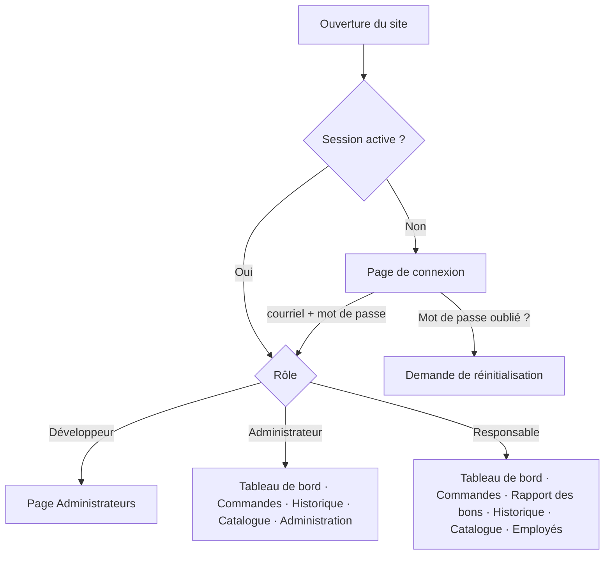
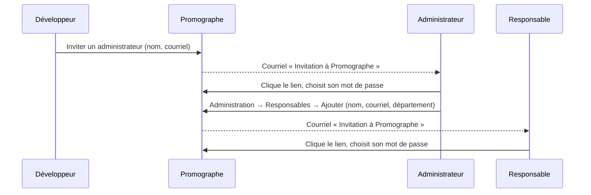
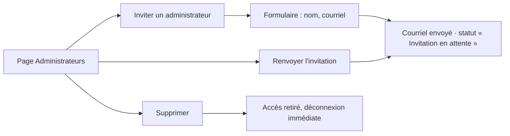
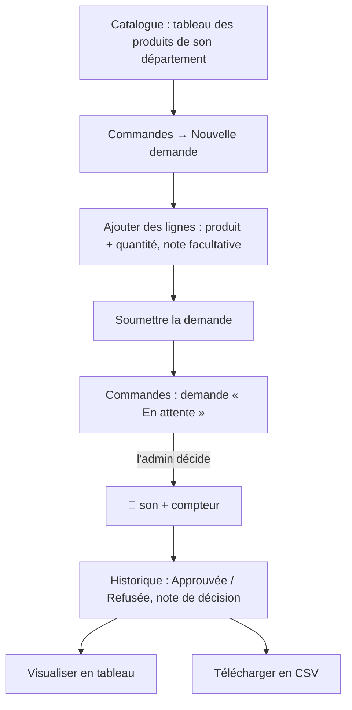
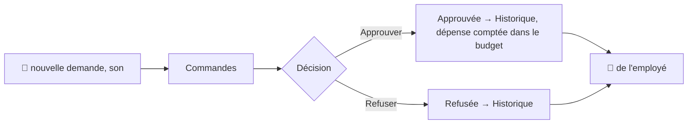

# App Flow — Parcours de l'application

**Date :** 12 octobre 2026

Les diagrammes s'affichent dans l'aperçu Markdown de VS Code et sur GitHub.

---

## 1. Vue d'ensemble

**En-tête commun** (après connexion) : nom de l'utilisateur · 🔔 cloche (sauf Développeur) · **Profil** · **Se déconnecter**.

## 2. Création des comptes (chaîne d'invitations)

- Le lien d'invitation est valable **24 h** et ne sert qu'une fois.
- Inviter de nouveau la même adresse renvoie un nouveau lien et annule l'ancien.

## 3. Connexion et compte

| Écran | Actions | Résultat |
|---|---|---|
| **Connexion** | Courriel + mot de passe → « Se connecter » | Ouvre l'application selon le rôle. Après 10 échecs : blocage 15 min. |
| **Mot de passe oublié** | Saisir son courriel | Message identique dans tous les cas ; si le compte existe, courriel avec un lien valable 1 h. |
| **Réinitialisation** | Nouveau mot de passe (2 fois) | Mot de passe changé, autres sessions déconnectées. |
| **Accepter l'invitation** | Choisir un mot de passe (2 fois) | Compte activé, retour à la connexion. |
| **Profil** (en-tête) | Modifier le nom complet ; voir courriel, rôle, département | « Profil enregistré. » |
| **Profil → Modifier le mot de passe** | Actuel + nouveau (2 fois) | Changé ; les autres sessions sont déconnectées. |
| **Se déconnecter** | — | Retour à la connexion. |

**Fin de session automatique :** fermeture du navigateur, ou 8 h sans activité. Si un autre compte se connecte dans le même navigateur, les onglets ouverts se rechargent avec un avertissement.

## 4. Parcours du Développeur

Le Développeur ne voit **aucun** onglet ni la cloche, et le serveur lui refuse toute autre donnée.

## 5. Parcours du Responsable de département

- Peut passer **autant de demandes** qu'il veut, y compris pour le même produit.
- Ne voit que les produits et les demandes de **son** département.
- Peut aussi ajouter ou modifier des produits de son département depuis le Catalogue.

## 6. Parcours de l'Administrateur

### 6.1 Navigation
| Onglet | Contenu |
|---|---|
| **Tableau de bord** | Budgets et dépenses (indicateurs et tableau des budgets par département), puis Achats (bons, demandes, dépenses par mois, fournisseur et catégorie, hausses de prix), pour l'année choisie |
| **Commandes** | Demandes **en attente** de tous les départements, avec Approuver / Refuser et une note |
| **Historique** | Boutons **Visualiser** (tableau) et **Télécharger en CSV** |
| **Catalogue** | Formulaire « Ajouter un produit » ; en dessous, liste des départements → tableau des produits (Modifier / Supprimer) |
| **Administration** | Menu de gauche : Responsables · Départements · Fournisseurs |

### 6.2 Traiter une demande

### 6.3 Administration (menu de gauche)
| Section | Ajouter | Modifier | Supprimer |
|---|---|---|---|
| **Responsables** | Invitation par courriel (nom, courriel, département) | Nom, département | Compte bloqué et masqué ; ses commandes restent dans l'historique |
| **Départements** | Nom | Renommer | Refusé s'il reste des responsables ou des demandes en attente ; sinon le département et ses produits disparaissent |
| **Fournisseurs** | Nom, contact, courriel, téléphone | Toutes les informations | Les produits restent, sans fournisseur |

### 6.4 Catalogue
1. Remplir « Ajouter un produit » (nom, description, département, fournisseur, prix, disponible).
2. Le tableau passe automatiquement au département du produit enregistré.
3. Supprimer un produit le retire du catalogue ; les commandes passées le gardent dans l'historique.

## 7. Règles d'affichage importantes

- **Commandes** = seulement les demandes en attente ; **Historique** = seulement les demandes traitées.
- La cloche vérifie toutes les 30 s et au retour sur l'onglet.
- Toute action refusée faute de droits recharge la page si le compte a changé dans le navigateur.
- Le CSV est régénéré à chaque téléchargement : il contient toujours les dernières décisions.
