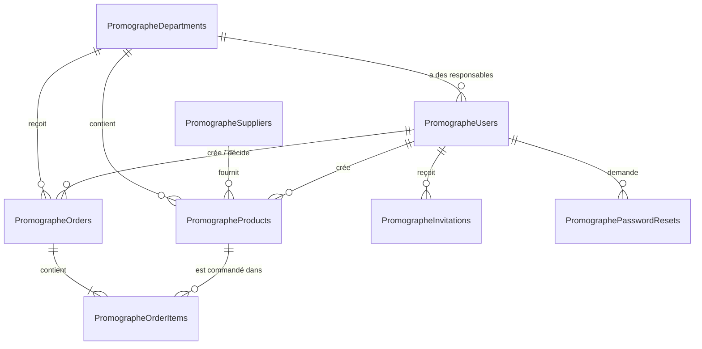

# Backend Schema — Base de données et API

**Date :** 12 octobre 2026
**Base :** Azure SQL `sql-promographe-v2` / `promographe` — schéma `dbo`, migrations 001 à 010.

---

## 1. Diagramme des tables

Les tables `PromographeSessions` et `PromographeSchemaMigrations` sont autonomes (aucune relation).

## 2. Tables

### PromographeUsers — comptes
| Colonne | Type | Règles |
|---|---|---|
| Id | int, identité | Clé primaire |
| Email | nvarchar(254) | **Unique**, en minuscules |
| PasswordHash | nvarchar(255) | Argon2id |
| Role | nvarchar(32) | `developer`, `admin` ou `department_manager` |
| DepartmentId | int, null | → Departments ; **obligatoire** pour `department_manager` |
| FullName | nvarchar(150) | Défaut `''` |
| IsActive | bit | 0 tant que l'invitation n'est pas acceptée, ou après suppression |
| SessionVersion | int | Incrémenté pour déconnecter les autres sessions |
| DeletedAt | datetime2, null | Suppression logique |
| CreatedAt | datetime2 | UTC |

### PromographeDepartments — départements
| Colonne | Type | Règles |
|---|---|---|
| Id | int, identité | Clé primaire |
| Name | nvarchar(100) | **Unique** |
| BudgetCents | bigint, null | Budget annuel en cents, ≥ 0 |
| DeletedAt | datetime2, null | Suppression logique ; recréer le même nom le restaure |
| CreatedAt | datetime2 | UTC |

### PromographeSuppliers — fournisseurs
| Colonne | Type | Règles |
|---|---|---|
| Id | int, identité | Clé primaire |
| Name | nvarchar(150) | **Unique** |
| ContactName, Email, Phone | nvarchar | Facultatifs (défaut `''`) |
| CreatedAt | datetime2 | UTC |

Suppression **physique** : les produits liés passent à `SupplierId = NULL`.

### PromographeProducts — catalogue
| Colonne | Type | Règles |
|---|---|---|
| Id | int, identité | Clé primaire |
| Name | nvarchar(150) | Obligatoire |
| Description | nvarchar(500) | Texte libre |
| Sku | nvarchar(50) | Code du produit chez le fournisseur, vide si inconnu |
| UnitPriceCents | int | ≥ 0 |
| DepartmentId | int, null | → Departments (index avec Name) |
| SupplierId | int, null | → Suppliers |
| IsActive | bit | Commandable ou non |
| CreatedByUserId | int | → Users |
| DeletedAt | datetime2, null | Suppression logique (garde l'historique intact) |
| CreatedAt | datetime2 | UTC |

### PromographeOrders — demandes
| Colonne | Type | Règles |
|---|---|---|
| Id | bigint, identité | Clé primaire |
| DepartmentId | int | → Departments |
| CreatedByUserId | int | → Users (le responsable) |
| Status | nvarchar(16) | `pending`, `approved` ou `rejected` |
| Notes | nvarchar(1000), null | Note du responsable |
| DecisionNote | nvarchar(1000), null | Note de l'admin |
| DecidedByUserId | int, null | → Users |
| CreatedAt / DecidedAt | datetime2 | UTC |

Index : `(DepartmentId, CreatedAt DESC)`.

### PromographeOrderItems — lignes de demande
| Colonne | Type | Règles |
|---|---|---|
| Id | bigint, identité | Clé primaire |
| OrderId | bigint | → Orders, **suppression en cascade** |
| ProductId | int | → Products |
| ProductName | nvarchar(150) | **Copie** du nom au moment de la demande |
| UnitPriceCents | int | **Copie** du prix au moment de la demande, ≥ 0 |
| Sku | nvarchar(50), null | **Copie** du SKU au moment de la demande |
| Quantity | int | > 0 |

### PromographeInvitations et PromographePasswordResets — jetons
| Colonne | Type | Règles |
|---|---|---|
| Id | bigint, identité | Clé primaire |
| UserId | int | → Users, cascade |
| TokenHash | char(64) | SHA-256 du jeton, **unique** |
| ExpiresAt | bigint | Horodatage en ms (24 h invitation, 1 h réinitialisation) |
| UsedAt | bigint, null | Usage unique |

### PromographeSessions — sessions
| Colonne | Type | Règles |
|---|---|---|
| Sid | nvarchar(256) | Clé primaire |
| SessionData | nvarchar(max) | JSON (userId, sessionVersion, csrfToken) |
| ExpiresAt | bigint | Ms ; nettoyage toutes les heures |

### PromographeSchemaMigrations
Une ligne par migration appliquée (`Version`, `AppliedAt`).

## 3. Règles de suppression

| Élément | Type | Conséquence |
|---|---|---|
| Produit | Logique | Invisible et non commandable ; les lignes de demande gardent nom et prix |
| Responsable / Administrateur | Logique | `IsActive = 0`, sessions coupées, invitations et réinitialisations effacées ; ré-inviter le courriel restaure le compte |
| Département | Logique | Refusée s'il a des responsables ou des demandes en attente ; ses produits sont supprimés logiquement |
| Fournisseur | Physique | Produits conservés, sans fournisseur |

## 4. Migrations

| N° | Fichier | Contenu |
|---|---|---|
| 001 | auth_and_invitations | Departments, Users, Invitations, Sessions, SchemaMigrations |
| 002 | products_and_orders | Products, Orders, OrderItems |
| 003 | product_departments | Products.DepartmentId |
| 004 | suppliers | Suppliers, Products.SupplierId |
| 005 | department_budgets | Departments.BudgetCents |
| 006 | user_full_names | Users.FullName |
| 007 | password_resets | Users.SessionVersion, PasswordResets |
| 008 | product_deletion | Products.DeletedAt |
| 009 | soft_delete_users_departments | Users.DeletedAt, Departments.DeletedAt |
| 010 | developer_role | Rôle `developer` |

Chaque migration est **idempotente** (vérifie l'existence avant de modifier) et appliquée dans une transaction avec verrou.

## 5. API

Toutes les routes répondent en JSON. Les écritures exigent l'en-tête `X-CSRF-Token` (obtenu par `GET /api/auth/csrf`, ou renvoyé à la connexion).

**Légende :** 🌐 public · 🔑 connecté · **D** Développeur · **A** Administrateur · **R** Responsable · ⏱ limité en débit

### 5.1 Authentification et compte
| Méthode | Route | Accès | Corps / réponse |
|---|---|---|---|
| GET | `/api/health` | 🌐 | `{ status }` |
| GET | `/api/auth/csrf` | 🌐 | `{ csrfToken }` |
| POST | `/api/auth/login` | 🌐 ⏱ | `{ email, password }` → `{ user, csrfToken }` |
| GET | `/api/auth/me` | 🔑 | `{ user: { id, email, fullName, role, departmentId, departmentName } }` |
| PATCH | `/api/auth/profile` | 🔑 | `{ fullName }` |
| POST | `/api/auth/change-password` | 🔑 ⏱ | `{ currentPassword, newPassword }` |
| POST | `/api/auth/password-reset/request` | 🌐 ⏱ | `{ email }` → 202 (toujours) |
| POST | `/api/auth/password-reset/validate` | 🌐 ⏱ | `{ token }` |
| POST | `/api/auth/password-reset/complete` | 🌐 ⏱ | `{ token, password }` |
| POST | `/api/auth/logout` | 🔑 | — |
| GET | `/api/auth/providers` | 🌐 | `{ microsoft, microsoftDomains }` |
| GET | `/api/auth/microsoft/login` · `/callback` | 🌐 | Connexion Microsoft (si configurée) |
| POST | `/api/invitations/validate` | 🌐 ⏱ | `{ token }` → `{ email, role, departmentName }` |
| POST | `/api/invitations/accept` | 🌐 ⏱ | `{ token, password }` |

### 5.2 Catalogue et commandes
| Méthode | Route | Accès | Corps / réponse |
|---|---|---|---|
| GET | `/api/products` | A (tous), R (son département) | `{ products }` |
| POST | `/api/products` | A, R | `{ name, description, priceCents, isActive, departmentId*, supplierName* }` (*admin) |
| PATCH | `/api/products/:id` | A, R (son département) | Mêmes champs |
| DELETE | `/api/products/:id` | A | Suppression logique |
| GET | `/api/orders` | A (toutes), R (son département) | `{ orders: [{ id, status, items[], totalCents, … }] }` |
| POST | `/api/orders` | R | `{ items: [{ productId, quantity }], notes }` → 201 `{ orderId }` |
| PATCH | `/api/admin/orders/:id` | A | `{ status: "approved" \| "rejected", decisionNote }` |

### 5.3 Administration
| Méthode | Route | Accès | Corps |
|---|---|---|---|
| GET | `/api/admin/dashboard?year=AAAA` | A | Budgets, montants approuvés / en attente, nombre de demandes par statut |
| GET / POST | `/api/admin/departments` | A | `{ name }` |
| PATCH / DELETE | `/api/admin/departments/:id` | A | `{ name }` / 409 si bloqué |
| PATCH | `/api/admin/departments/:id/budget` | A | `{ budgetCents }` |
| GET / POST | `/api/admin/suppliers` | A | `{ name, contactName, email, phone }` |
| PATCH / DELETE | `/api/admin/suppliers/:id` | A | Mêmes champs |
| GET | `/api/admin/users` | A | Comptes non supprimés |
| POST | `/api/admin/invitations` | A | `{ fullName, email, departmentId }` |
| PATCH / DELETE | `/api/admin/users/:id` | A | `{ fullName, departmentId }` |

### 5.4 Développeur
| Méthode | Route | Accès | Corps |
|---|---|---|---|
| GET | `/api/developer/admins` | D | `{ admins }` |
| POST | `/api/developer/admins` | D ⏱ | `{ fullName, email }` (invitation) |
| DELETE | `/api/developer/admins/:id` | D | Retrait d'accès |

### 5.5 Codes de réponse
| Code | Sens |
|---|---|
| 200 / 201 / 202 / 204 | Succès |
| 400 | Donnée invalide (message en français) |
| 401 | Non connecté ou session expirée |
| 403 | Rôle insuffisant, ou jeton CSRF manquant |
| 404 | Introuvable |
| 409 | Conflit (nom déjà utilisé, suppression bloquée, produit indisponible) |
| 429 | Trop de tentatives |
| 502 / 503 | Courriel non envoyé / non configuré |
