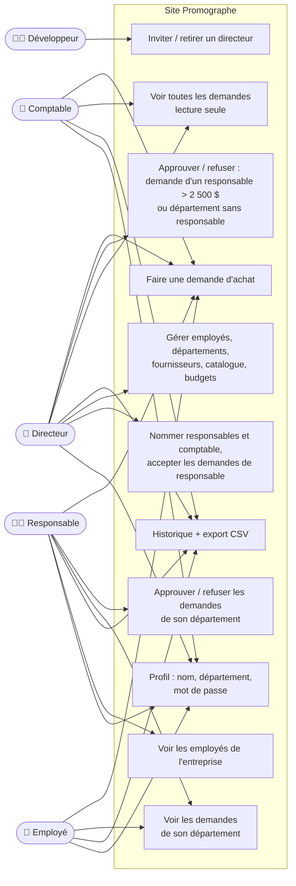
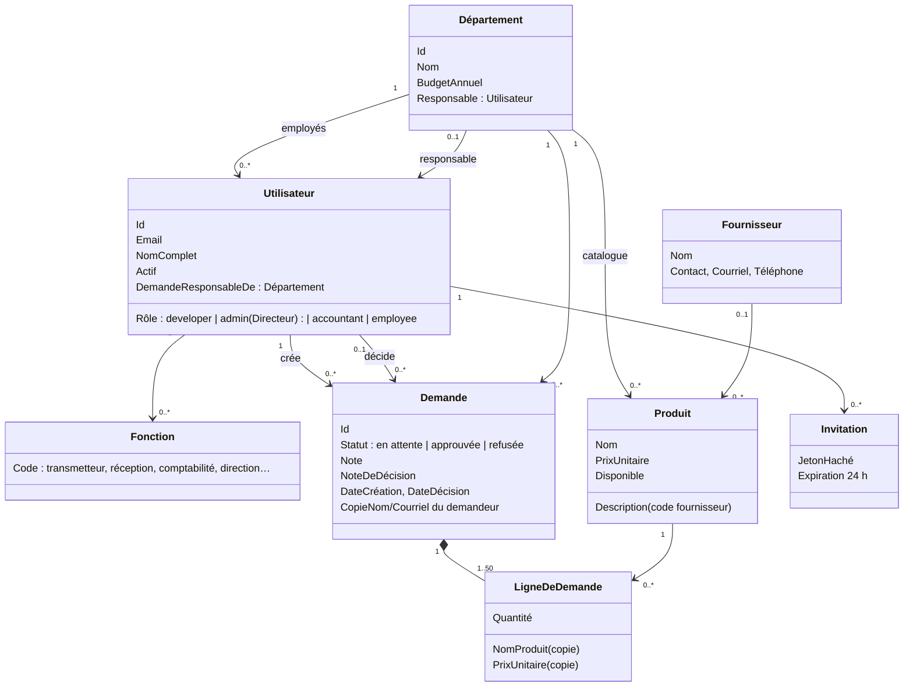
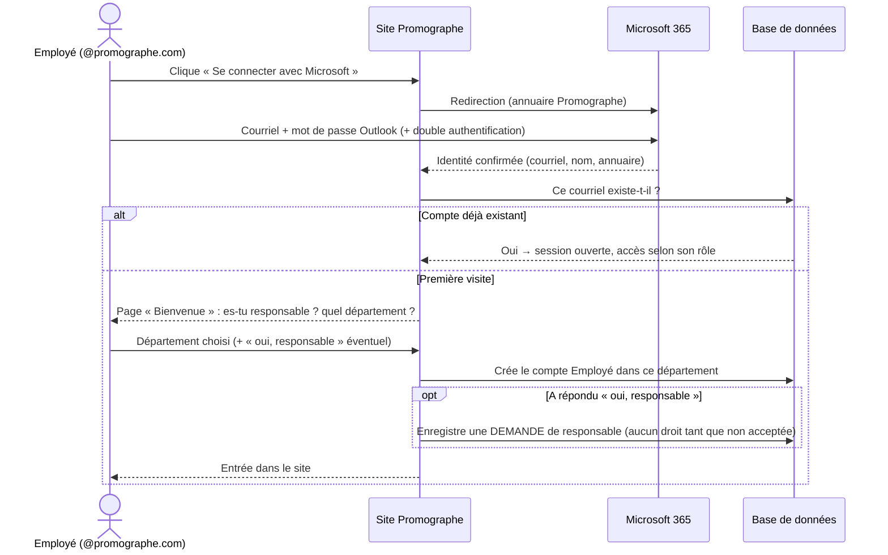
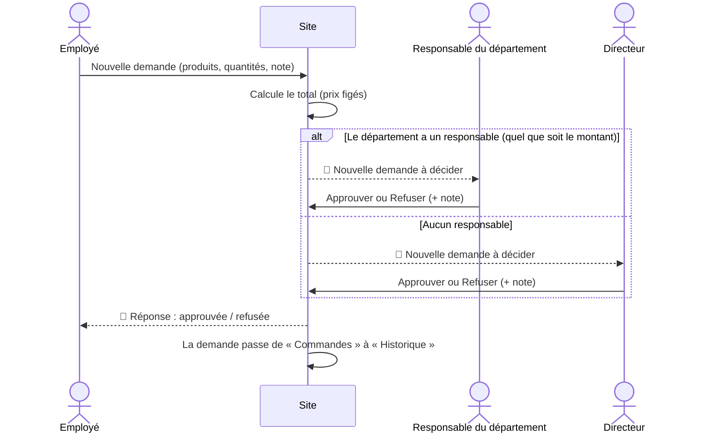
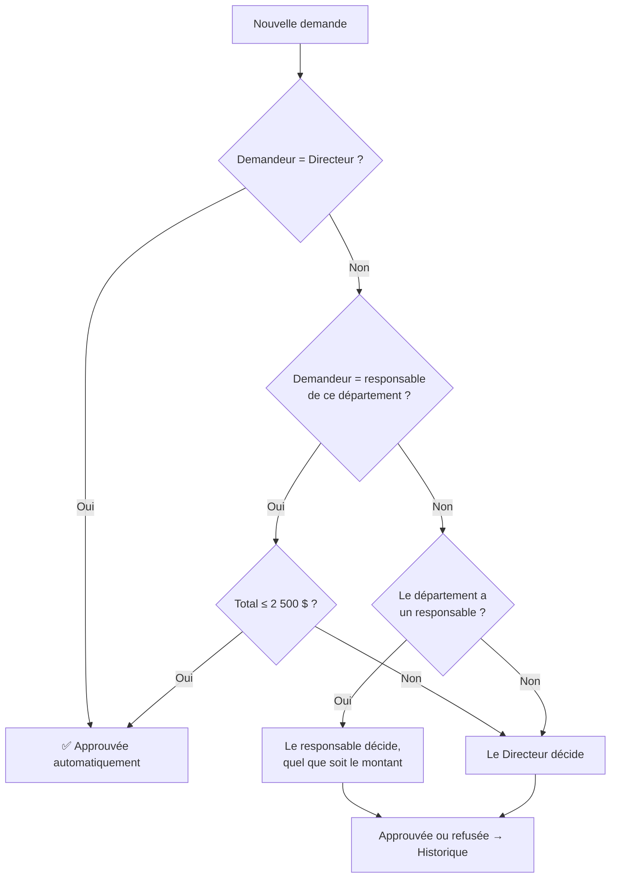
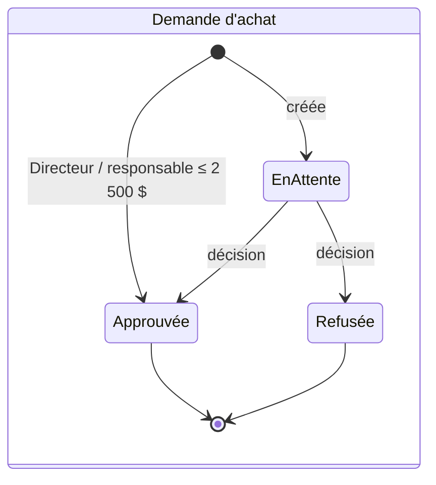

# UML — Comment fonctionne Promographe

**Date :** 15 octobre 2026
Pour voir les diagrammes dans VS Code : ouvrir ce fichier puis **Ctrl+Maj+V** (aperçu).

---

## 1. Cas d'utilisation — qui fait quoi



| Acteur | Demande approuvée automatiquement ? |
|---|---|
| Directeur | Oui, quel que soit le montant |
| Responsable | Oui jusqu'à 2 500 $ (pour son département) ; au-delà, elle va au Directeur |
| Comptable, Employé | Non : elle attend une décision |

---

## 2. Diagramme de classes — les données



---

## 3. Séquence — première connexion avec Microsoft



---

## 4. Séquence — une demande d'achat



---

## 5. Activité — qui décide d'une demande ?



---

## 6. États — une demande et un compte

```mermaid
stateDiagram-v2
    direction LR
    state "Compte utilisateur" as Compte {
      [*] --> Invité : invitation par courriel
      [*] --> Actif : 1re connexion Microsoft
      Invité --> Actif : lien accepté (24 h)
      Actif --> Actif : changement de rôle / département
      Actif --> [*] : supprimé (effacé de la base ;<br/>les demandes restent dans l'historique)
      Invité --> [*] : supprimé
    }
```





---

## 7. Déploiement — où tourne le site

```mermaid
flowchart LR
    U[Navigateur<br/>ordinateur / téléphone] -- HTTPS --> APP

    subgraph Azure — groupe rg-promographe-v2
      APP[App Service promographe-v2<br/>Node.js / Express]
      SQL[(Azure SQL<br/>sql-promographe-v2 / promographe)]
      MAIL[Azure Communication<br/>Services — courriels]
    end

    ENTRA[Microsoft Entra ID<br/>annuaire Promographe]

    APP -- identité managée, sans mot de passe --> SQL
    APP -- invitations, mot de passe oublié --> MAIL
    APP -- « Se connecter avec Microsoft » --> ENTRA
```
